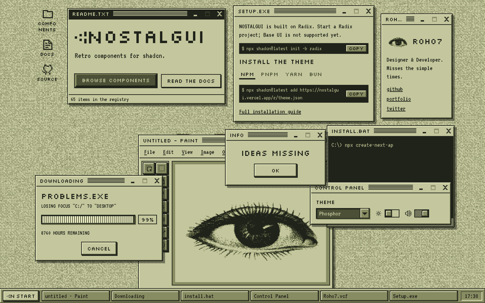

# NOSTALGUI

Retro, 1-bit, Win95-flavoured components for shadcn. Square corners, four inks, stepped motion and ordered dither. Install them with the shadcn CLI and the code is yours to change.



## Documentation

Visit [nostalgui.vercel.app/docs](https://nostalgui.vercel.app/docs) for the guides, and [nostalgui.vercel.app/components](https://nostalgui.vercel.app/components) for every component and variant.

## Install

NOSTALGUI is built on Radix. Base UI projects are not supported yet.

```bash
npx shadcn@latest init -b radix
```

```bash
npx shadcn@latest registry add "@nostalgui=https://nostalgui.vercel.app/r/{style}/{name}.json"
```

```bash
npx shadcn@latest add @nostalgui/theme @nostalgui/button
```

The CLI fills `{style}` from your `components.json`. No icon pack ships with the theme; [pixelarticons-react](https://github.com/gitntg/pixelarticons-react) sits on the same pixel grid and is what this site uses.

### Sounds

Every button, switch, menu and slider can click like real hardware. Sound is opt-in. The [Sound guide](https://nostalgui.vercel.app/docs/sound) explains how the clicks are made and how to tune them.

```bash
npx shadcn@latest add @nostalgui/sound
```

This adds the sound engine, a `sounds.json` next to your `components.json` and `scripts/dither-sounds.mjs`. Render the player once in your root layout:

```tsx
import { NostalguiSounds } from "@/components/ui/nostalgui-sounds"

export default function RootLayout({ children }: { children: React.ReactNode }) {
  return (
    <html lang="en">
      <body>
        {children}
        <NostalguiSounds />
      </body>
    </html>
  )
}
```

Then pull in the sounds of the components you installed. Rerun it after adding more; it keeps your edits.

```bash
node scripts/dither-sounds.mjs sync
```

Silence one element with `data-sound="none"`, give it another sound with `data-sound="my-key"`, turn a sound off in `sounds.json` with `"key": false`, or everything with `"enabled": false`.

## Contributing

### Setup

```bash
git clone https://github.com/Roho7/nostalgui.git
cd nostalgui
npm install
npm run dev
```

The desktop is at `/`, the catalogue at `/components` and the docs at `/docs`.

### Add a component

1. Scaffold a shadcn component, or write an original under `components/retro/`:

   ```bash
   node scripts/add-shadcn.mjs add <name>
   ```

   This copies shadcn's source into `components/ui/`, adds the registry item and a stub demo, and ticks `ROADMAP.md`.

2. Restyle it to the rules in [`docs/DESIGN.md`](docs/DESIGN.md): square corners, `--pixel` borders, the four ink tokens, dither instead of alpha, stepped motion instead of tweens, and icons from `components/ui/pixel-glyphs.tsx`.
3. Fill in `components/showcase/demos/<name>.tsx` with every variant, size and state.
4. If it is interactive, give it a sound: map its `data-slot` in `lib/sound/sound-slots.ts`, add the patches to `sounds.json`, and list their keys in the item's `meta.sounds` in `registry.json`.
5. Rebuild the registry:

   ```bash
   npm run registry:build
   ```

### Before you open a PR

```bash
npm run verify
```

This runs lint, typecheck, the style contract (`scripts/check-style.mjs`) and the docs generator. The style check fails on rounded corners, alpha colours, tweened motion and an unticked roadmap entry. Then check your component in the browser in at least one light and one dark palette.

See [`ROADMAP.md`](ROADMAP.md) for what ships and what is still open.

## License

Licensed under the [MIT license](LICENSE).
